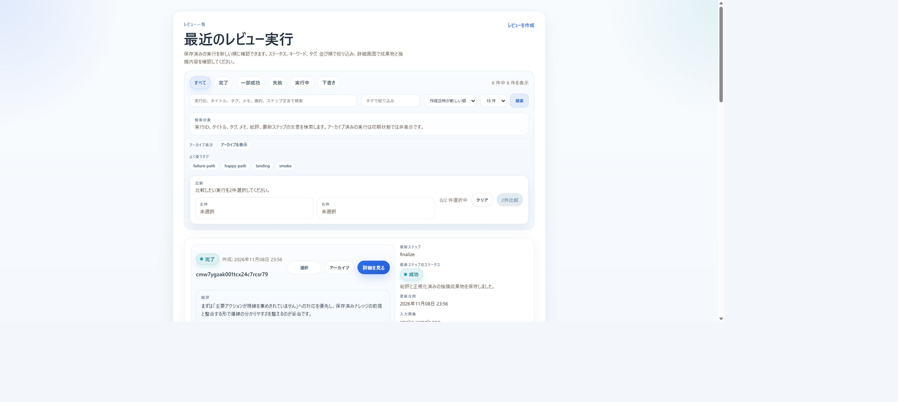

# AI Review Hub

[](https://github.com/taki-codes/ai-expert-review-hub-portfolio/actions/workflows/verify.yml)

[設計・コードの読みどころと検証結果](docs/portfolio.md)

スクリーンショットのUIレビュー、Figmaの設計情報、静的解析・セキュリティレポートを、1つのレビュー履歴に集約するWebアプリです。複数のツールで得た指摘を共通形式にそろえ、修正前後の比較まで行うMVPとして開発しています。

## 画面例



モックと合成入力による動作確認画面です。実サービスのレビュー結果ではありません。

## 主な機能

- スクリーンショットと説明文からレビューを作成し、実行状況・要約・指摘を保存
- ステータス、キーワード、タグによる検索とページ送り
- 2件のレビューを比較し、指摘数・ステータス・タグ・メモの差を確認
- 作成時のタイトル・タグ・メモ設定、レビューのアーカイブと復元
- 一般向けの結果画面と、開発者向けの保存成果物画面を分離

## 連携の実装範囲

| 連携 | 現在の役割・実行方法 |
| --- | --- |
| Gemini | UIレビューの一次評価。`mock` / `real` を環境変数で切り替え |
| GPT | 結果の正規化、優先順位付け、エグゼクティブサマリー。`mock` / `real` 対応 |
| Figma | ファイル・ノード情報の読み取り専用取得。`mock` / `real` 対応 |
| Figma Make / Check designs | 生成結果の手動キャプチャ、監査結果の手動取り込み |
| Semgrep | JSONレポート取り込み、またはローカルのSemgrep実行 |
| ZAP | API仕様とJSONレポートの取り込み、またはモックのAPIスキャン |
| CodeQL | 公開リポジトリを対象とするSARIF / JSONレポート取り込み |

初期設定ではGemini・GPT・Figmaをモックで動かせるため、APIキーなしで画面とレビュー処理の流れを試せます。実APIの利用には各サービスの認証情報が必要です。

## 実サービスで確認したこと

元の開発版では、Geminiでスクリーンショットをレビューし、GPTで指摘を整理して優先順位と要約を作る一連の処理を、実APIで確認しました。各ステップの入出力と最終結果を保存し、任意の解析入力がそろわない回でも、成功したレビューの結果を取り出せることを確認しています。

Figmaでは、アクセス権のある共有ファイルを読み取り、設計情報と要約が保存されることを実サービスで確認しました。無効なトークンと閲覧権限のないファイルも個別に試し、Figmaの失敗理由を残したまま最終集計まで進むことを確認しています。公開版のCIでは、モックとローカルのFigmaスタブで対応する経路を再現します。[セットアップと検証手順](docs/setup-and-verification.md)

## 技術構成

| 領域 | 技術 |
| --- | --- |
| UI・API | Next.js 15 App Router、React 19、TypeScript |
| データ保存 | Prisma 6、SQLite |
| 成果物保存 | 実行IDごとのローカルディレクトリ |
| 検証 | Node.jsによるAPI・画面のスモークテスト、ローカルFigmaスタブ |

## ローカルで動かす

Node.jsとnpmを用意します。以下はPowerShellの例です。

```powershell
git clone https://github.com/taki-codes/ai-expert-review-hub-portfolio.git
cd ai-expert-review-hub-portfolio/apps/web
Copy-Item .env.example .env
npm ci
npm run prisma:generate
npm run db:init
npm run dev
```

[http://localhost:3000](http://localhost:3000)を開き、スクリーンショットと説明文を入力してレビューを作成します。一覧は `/reviews` から確認できます。

`.env` は初期値の `GEMINI_ADAPTER_MODE=mock`、`GPT_ADAPTER_MODE=mock`、`FIGMA_ADAPTER_MODE=mock` を使用します。SQLiteのパスは `DATABASE_URL="file:./dev.db"` のままにしてください。相対パスの基準は `apps/web/prisma/schema.prisma` です。

実APIを試す場合は対象のモードを `real` にし、`.env.example` にある対応キーを設定します。Figmaは `file_content:read` 権限と対象ファイルへのアクセスが必要です。リクエストに含めた画像・説明・設計情報は、選択した外部サービスに送信されます。

## 設計上のポイント

- **連携ごとのアダプター分離**：プロバイダー固有の呼び出しと、レビューの保存・表示を分離しています。
- **共通の指摘モデル**：ツールごとの出力を、出典・重要度・理由・修正提案などの共通項目に正規化します。
- **途中経過を残す実行モデル**：任意連携が失敗しても `partial_success` として最終集計まで進み、失敗したステップと理由を確認できます。
- **追跡可能な成果物**：入力、リクエスト、応答、最終要約を実行ID単位で保存し、結果の根拠をたどれます。

処理の基本経路は `ingest → gemini → gpt → 任意連携 → finalize` です。必須ステップが失敗した場合は `failed` とし、未実行ステップを `skipped` にします。

## 検証

セットアップ後、`apps/web` で実行します。

```powershell
npm run build
npm run test:api:smoke
```

スモークテストでは、成功・任意連携失敗・連携スキップの代表ケースに加え、作成・検索・比較・アーカイブ・復元とFigmaアダプターのスタブ接続を確認します。実サービスへの疎通は別の手動検証です。

2026年11月8〜9日、Windows / Node.js 24.22.1で本番ビルドとスモークテストの成功を確認しました。空のSQLite DBからも成功しています。テスト用サーバーはNode.jsから直接起動・終了します。実際の確認環境と連携範囲は [検証結果](docs/portfolio.md#確認結果) を参照してください。

## 現在の制約

- 認証・所有者管理・チーム共有履歴は今後の拡張対象です。現在は信頼できるローカル環境での試用を想定しています。
- ZAPによる実サイトへの自動スキャンと、CodeQL自体の実行は行いません。
- Figmaへの書き戻し、コードの自動修正、PR作成・マージは対象外です。
- 動画入力は構想に含まれますが、現在の作成APIの必須入力はスクリーンショットと説明文です。

## 構成と関連資料

| パス | 内容 |
| --- | --- |
| [apps/web](apps/web) | 画面・API・プロバイダーアダプター・検証スクリプト |
| [contracts](contracts) | JSON Schemaと共通契約 |
| [docs/architecture.md](docs/architecture.md) | 実行経路・永続化・失敗時の設計 |
| [docs/setup-and-verification.md](docs/setup-and-verification.md) | 連携モード・成果物・API・既存の検証手順 |
| [integrations/README.md](integrations/README.md) | 連携境界 |


## この公開用ソースについて

[元のコードとの差分・含める範囲](PORTFOLIO-SOURCE.md)を参照してください。個別の運用情報と元のGit履歴を含まない公開用ソースです。
