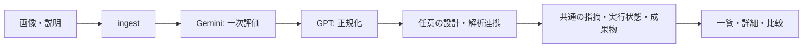

# 設計と検証の読みどころ

外部AIや解析ツールの結果を同じモデルに保存し、失敗理由と根拠を追えるWeb・API設計の例です。初期モックで一連の画面を試せます。

## コードを読む順番

1. [API](../apps/web/src/app/api/reviews/route.ts): 入力の受け付け。
2. [review-orchestrator.ts](../apps/web/src/lib/queue/review-orchestrator.ts): 必須・任意ステップと最終状態。
3. [adapters](../apps/web/src/lib/adapters): プロバイダー固有の入出力。
4. [review-repository.ts](../apps/web/src/lib/storage/review-repository.ts): 保存・検索・比較。
5. [api-smoke-test.mjs](../apps/web/scripts/api-smoke-test.mjs): APIと画面を通した代表的な経路。

必須処理の失敗と任意連携の失敗を分け、任意連携が失敗しても結果を確認できる形にしています。元の要求・応答も実行単位で保存するため、正規化結果だけでは分からない原因を調べられます。一方、保存先の管理と認証・所有者管理は、外部公開サービスにする前の課題です。

## 確認結果

2026年11月8〜9日、Windows / Node.js 24.22.1 / lockfile解決版Next.js 15.5.15・Prisma 6.19.3で、`prisma:generate`、`db:init`、`build`、`test:api:smoke` が成功しました。独立した空のSQLite DBからもスモークテストが成功しています。

確認範囲はレビュー作成、成功・任意連携失敗・スキップ、検索・ページ送り、比較、アーカイブ・復元、成果物の表示、ローカルFigmaスタブへのHTTP接続です。Gemini / GPTはモックです。Figmaの実アダプターはローカルスタブを対象にし、外部Figmaや実LLMへ接続した成功とは区別しています。

今回、初期DBでアーカイブ後の件数を誤って期待していたテストを修正し、テスト用サーバーはNode.jsから直接起動・終了する形にしました。Next.jsのファイル追跡範囲もリポジトリのルートへ固定しています。
